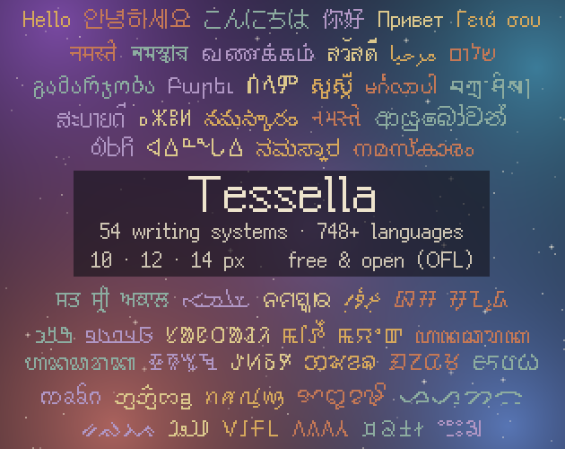
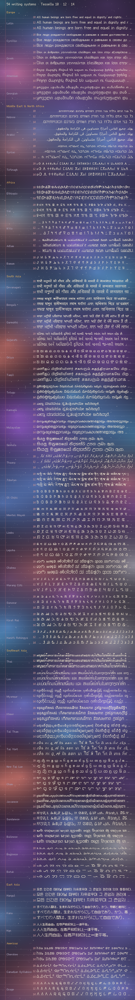

# Tessella

**A pixel font family for 54 writing systems on one grid — in 10, 12 and 14 px.**
Covers **748+ languages**: 736 found by [Hyperglot](https://hyperglot.rosettatype.com) 0.8.1 (measured with a fix for its decomposition-order bug; the unmodified tool reports 725), plus 12 languages not in the Hyperglot database (Santali, Limbu, Eastern and Western Cham, Osage, Sunuwar, Bantawa, Rohingya, Ho, Lepcha, Tai Lü, Northern Thai).
Made by Claude AI (Anthropic), who brought the source fonts onto one pixel grid and corrected and unified them; letter-shape changes were checked by blind reading. Free under the SIL Open Font License 1.1.

**Why**: pixel fonts for small sizes exist for a few major scripts, but most of the world's scripts are left out — often their only pixel font is GNU Unifont, a 16px fixed-width font, and the pixel fonts that do exist come in different sizes, weights and heights. Tessella brings these scripts, including smaller and often overlooked ones such as Ol Chiki, Osage, Vai and Kirat Rai, onto the same grid as Latin, Chinese or Arabic, so that every language can stand on equal footing in games and apps.

## Download

Get the zip for the size you need from **[Releases](../../releases)** (`Tessella-10.zip`, `Tessella-12.zip`, `Tessella-14.zip`), or take single files from [`fonts/`](fonts). Also on itch.io: https://2g1ygames.itch.io/tessella

## What is in this repository

`fonts/10`, `fonts/12`, `fonts/14` — one TTF per writing system, named `Tessella<size>-<script>.ttf` — for example `Tessella12-devanagari.ttf`.
Every file also contains Basic Latin and Latin-1 (A–Z, digits, punctuation, é ü ñ …) and common symbols (arrows, math, box drawing, shapes ▶ ○ ■, ⚠ ✓ ✗ …), so mixed text works. Combining diacritics (U+0300–036F) are in the Latin, Cyrillic, Greek and other non-shaping files and in the Korean, Japanese and Chinese files, not in the shaping-script files.

| Size | Line | Baseline |
|---|---|---|
| Tessella 10 | 14 px | row 11 |
| Tessella 12 | 16 px | row 13 |
| Tessella 14 | 17 px | row 14 |

Pick the file for your language: `latin` for English, French, Vietnamese, Yoruba …; `cyrillic` for Russian, Ukrainian, Kazakh …; `hangul-ko` for Korean; `kana-ja` for Japanese; `han-sc` / `han-tc` for Chinese; and one file each for the other scripts.

## How to use

- Set the font size to **12 px (9 pt at 96 dpi)** for every size — Tessella 10 and 14 are drawn on their own grids inside that em.
- Turn **anti-aliasing off** (or use nearest-neighbour scaling) for crisp pixels.
- Scripts that need shaping (Devanagari, Bengali, Tamil, Thai, Arabic, Khmer, Myanmar, Tibetan and more) are real OpenType fonts: conjuncts, reordering and marks work in apps and engines that do OpenType shaping (tested with HarfBuzz, which web browsers, Godot and Unreal use; support for less common scripts varies between systems).
- Engines that do not shape text (GameMaker, Unity TextMeshPro) will show these scripts unshaped. Pre-shaping them at build time is needed; a GameMaker tool for this is planned.

## How it was made

- **The grid** comes from Fusion Pixel: Latin, Greek, Cyrillic, kana, Hangul and Han are Fusion Pixel (12 px for sizes 12 and 14, 10 px for size 10).
- **Other scripts** are Noto fonts rasterized at the same pixel size and corrected by hand. Many Lao and Cherokee letters are redrawn by hand; Khmer, Myanmar and Tibetan are heavily reworked; Kirat Rai is based on SIL Kanchenjunga.
- **Symbols and marks**: Fusion Pixel first, then Galmuri and misc-fixed 6x13 (size 10: misc-fixed 6x10, 6x9, 5x8, 6x12 and Galmuri7; known source errors such as Galmuri7's swapped ∩ ∪ are avoided). Box drawing and blocks fill the whole line so they connect between rows; proportional text inside a table will not line up in columns.
- **Fusion Pixel's pixel habits** (curve-end treatment, no 2×2 clumps, 1 px stems) are applied script by script, only where blind reading showed no loss.
- **Tessella 14** is Tessella 12 enlarged by inserting rows and columns, so strokes stay 1 px. **Tessella 10** reduces Tessella 12 by removing rows chosen to keep strokes and counters; Telugu, Gujarati, Sinhala, Khmer and Syriac are Noto rasterized at 10 px.
- **Shaping** uses the OpenType layout tables (GSUB/GPOS) of the source Noto fonts, with mark positions rounded to whole pixels.
- **Verification**: changes to letter shapes were checked by independent AI readers who transcribed rendered text without knowing the source; changes that made any letter harder to read were undone. Every file passes the OpenType Sanitizer, and text in 180 languages renders without missing glyphs.

## Reporting problems

If a letter looks wrong or is hard to read in your language, please **[open an issue](../../issues)** with the script, the size (10, 12 or 14), the text you typed and a screenshot. Native readers' reports are the most valuable thing this project can get.

## Honest limits

- AI readers are not native readers. Final judgment belongs to native readers and language institutions — reports are welcome.
- Letter skeletons follow their sources; Tessella unifies the grid and pixel habits, not the letterforms.
- Not yet covered: 194 rare Latin Extended-D/E characters, Cyrillic Extended-A (combining Cyrillic letters) and 107 other rare Cyrillic characters, Garay, Ol Onal; combining diacritics in the shaping-script files.
- Language-specific forms (Serbian/Macedonian Cyrillic, Marathi/Nepali Devanagari, Urdu Nastaliq) use the default forms. OpenType `locl` from Noto is kept where the source has it.
- Mark positions are rounded to whole pixels, so a few marks may sit 1 px from where the source font puts them.
- Han coverage follows Fusion Pixel. Tessella 12 and 14 cover JIS X 0208, GB2312 level 1 and Big5 common characters fully (a few hundred rarer GB2312/Big5/KS X 1001 characters are missing). Tessella 10 has the same common sets, but about 10,000 rarer Han characters exist only in 12 and 14.

## License and sources

Tessella is licensed under the SIL Open Font License 1.1 (`OFL.txt`). You may use, embed, modify and redistribute it, including in commercial games; the fonts may not be sold on their own.
It is derived from Fusion Pixel, Galmuri, the Noto families, SIL Kanchenjunga (all OFL 1.1) and misc-fixed (public domain). Their notices are in `OFL.txt` and `licenses/`. Reserved font names of the sources are not used.

---

# Tessella (한국어)

- **받기**: [Releases](../../releases)에서 크기별 zip, 또는 [`fonts/`](fonts)에서 파일 하나씩 · itch.io: https://2g1ygames.itch.io/tessella
- **오류 제보**: 글자가 틀리거나 읽기 어려우면 [Issues](../../issues)에 문자·크기·입력한 글·스크린샷을 남겨 주세요.

**54개 문자를 하나의 격자에 담은 픽셀 글꼴 가족 — 10 · 12 · 14 px.**
**748개 이상 언어**: Hyperglot 0.8.1 측정 736(분해 글자 순서 버그를 고쳐 잼 · 그대로 돌리면 725) + Hyperglot 데이터베이스에 없는 언어 12(산탈리·림부·동/서 참·오세이지·수누와르·반타와·로힝야·호·렙차·타이 르·북부 태국어).
Claude AI(Anthropic)가 원본 글꼴을 한 픽셀 격자로 옮기고 손질·통일했으며, 글자 모양을 바꾼 것은 눈가림 판독으로 확인했다. SIL Open Font License 1.1 로 무료.

**목적**: 작은 크기의 픽셀 글꼴은 몇몇 주요 문자에만 있고 세계 대부분의 문자는 빠져 있다 — 픽셀 글꼴이 16px 고정폭 GNU Unifont 하나뿐인 문자가 많고, 있는 글꼴도 크기·굵기·높이가 다르다. Tessella 는 올치키·오세이지·바이·키라트 라이처럼 작고 소외되기 쉬운 문자까지 라틴·한자·아랍 문자와 같은 격자에 맞춰, 게임과 앱에서 모든 언어가 같은 자리에 설 수 있게 한다.

- **파일**: 문자마다 TTF 하나(`Tessella<크기>-<문자>.ttf`). 모든 파일에 라틴 기본·라틴-1·기호(화살표·수학·상자·도형 ▶ ○ ■ · ⚠ ✓ ✗ …)가 들어 있다. 결합 부호(U+0300–036F)는 라틴·키릴·그리스 등 셰이핑 없는 문자 파일과 한중일 파일에만 있다.
- **쓰는 법**: 크기를 **12px(96dpi 의 9pt)** 로, **안티에일리어싱을 끄고** 쓴다. 10·14 도 같은 크기 설정에서 제 격자로 그려진다.
- **결합 문자**(데바나가리·벵골·타밀·태국·아랍·크메르·미얀마·티베트 등)는 진짜 OpenType 이라, OpenType 셰이핑을 하는 프로그램·엔진에서 결합된다(HarfBuzz 로 시험 — 브라우저·Godot·Unreal 이 쓴다 · 드문 문자의 지원은 운영체제마다 다르다). 셰이핑을 하지 않는 엔진(GameMaker·Unity TextMeshPro)은 미리 짜는 도구가 필요하다(GameMaker 도구 예정).
- **만든 방법**: 격자 = Fusion Pixel(라틴·그리스·키릴·가나·한글·한자) · 그 밖 = Noto 를 같은 화소 크기로 래스터한 뒤 손질 · 기호·부호 = Fusion → Galmuri·misc-fixed 6x13(10 = misc-fixed 6x10·6x9·5x8·6x12·Galmuri7 · Galmuri7 의 ∩ ∪ 뒤바뀜 같은 원본 오류는 피함) · 상자·블록은 줄끼리 이어지게 칸을 채움(비례폭이라 표 안 글자 열은 맞지 않음) · Fusion 의 화소 버릇을 판독으로 확인한 문자에만 · 14 = 12 늘림 · 10 = 12 줄임(획·고리를 지키도록 고른 행) · 결합 규칙 = Noto 의 OpenType 표.
- **한계**: AI 판독자는 원어민이 아니다 · 글자 뼈대는 원본을 따른다 · 라틴 확장-D·E 희귀 글자 194자, 키릴 확장-A(결합 키릴 글자)와 그 밖의 희귀 키릴 107자, 가라이·올 오날, 셰이핑 문자 파일의 결합 부호는 아직 없다 · 한자 = Fusion Pixel 수록(12·14 = JIS X 0208·GB2312 1급·Big5 상용자 전부 · 10 = 같은 상용자 전부, 희귀 한자 약 1만 자는 12·14 에만) · 언어별 글자꼴(세르비아·마라티·우르두 나스탈리크)은 기본 꼴 · 부호 위치는 화소로 반올림.
- **라이선스**: SIL Open Font License 1.1 — 게임 포함 상업적 사용·수정·재배포 가능, 글꼴만 단독으로 파는 것은 금지. 출처 고지는 `OFL.txt` 와 `licenses/`.
